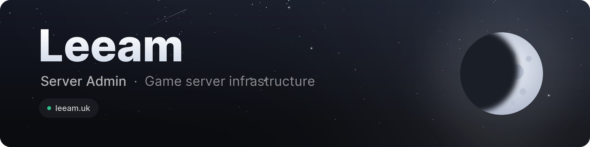

# Hi, I'm Leeam

I run game server infrastructure: 300+ VMs across 6 locations, on Linux, Proxmox and Docker. I'm a student in the UK, and most of what I build is the tooling around that.

**Portfolio:** [leeam.uk](https://leeam.uk)

## What I work with

- Linux servers, Proxmox and Docker
- Monitoring with Prometheus and Grafana
- Networking with Cloudflare, Tailscale and nginx
- TypeScript, Python and Rust for the tools around it all

## Things I've built

- **[maiIndex](https://github.com/lucideds/maiIndex)**: a searchable index and format converter for maimai DX chart archives. [Live](https://maiindex.lucideds.xyz)
- **[mc-ai](https://leeam.uk/projects/mc-ai)**: ask for work in Discord, and an AI writes a sandboxed script that a swarm of Minecraft bots runs (write-up)

## Contact

[Discord](https://discordapp.com/users/1052290524427591731) · [Email](mailto:lucideds@proton.me)
